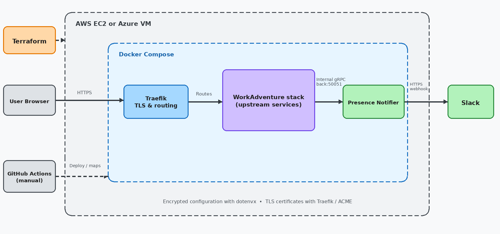

# WorkAdventure Self-Hosted

[](LICENSE)

A community-maintained self-hosting setup for [WorkAdventure](https://workadventu.re) using Docker Compose and Terraform.

This project is not affiliated with or endorsed by the WorkAdventure core team. WorkAdventure is developed by [TheCodingMachine](https://www.thecodingmachine.com/). See the [upstream repository](https://github.com/workadventure/workadventure) for the official source code and documentation.

## What this repository provides

- Terraform configurations for AWS EC2 and Azure VM deployments
- A Docker Compose stack for running WorkAdventure and its supporting services
- HTTPS routing and ACME certificate management with Traefik
- Encrypted environment configuration with dotenvx
- Manual GitHub Actions workflows for stack deployment and map uploads
- Optional integrations for Microsoft Entra ID OIDC, Matrix/Synapse, LiveKit, TURN, recording storage, and Slack presence notifications

## Contents

- [What this repository provides](#what-this-repository-provides)
- [Architecture](#architecture)
- [Community and Security](#community-and-security)
- [Getting Started](#getting-started)
  - [Upload a map](#upload-a-map-edited-with-tiled)
  - [Set up GitHub Actions](#set-up-github-actions)
  - [Set up presence notifications](#set-up-presence-notifications)
  - [Set up Microsoft Entra ID OIDC](#set-up-microsoft-entra-id-oidc)
  - [Set up LiveKit](#set-up-livekit)
  - [Set up Coturn](#set-up-coturn)
  - [Set up Matrix/Synapse](#set-up-matrix)
  - [Set up Egress with RustFS](#set-up-egress-with-rustfs)

## Architecture



This diagram focuses on the infrastructure and integrations maintained by this repository. WorkAdventure's upstream application services are intentionally represented as a single stack.

[Open the editable Excalidraw source](docs/architecture/workadventure-self-hosted-architecture.excalidraw).

## Community and Security

Contributions are welcome. Read [CONTRIBUTING.md](CONTRIBUTING.md) before opening an issue or pull request. Report vulnerabilities privately according to [SECURITY.md](SECURITY.md).

## Getting Started

- This guide supports both AWS EC2 and Azure VM with Terraform.

### Prepare Local Repository

```bash
# Local

# Clone repository
git clone https://github.com/Arata1202/workadventure-self-hosted.git
cd workadventure-self-hosted

# Install dependencies
make wa-init
```

### Create Resources with Terraform

When using Azure, generate an SSH key first:

```bash
# Local

ssh-keygen -t ed25519 -C "workadventure" -f ~/.ssh/workadventure -N ""
```

```bash
# Local

# Move to repository
cd workadventure-self-hosted
cd terraform/aws # or terraform/azure

# Prepare and edit local values
cp terraform.tfvars.example terraform.tfvars
vi terraform.tfvars

# Create resources
terraform init
terraform plan
terraform apply
```

For Azure, set `ssh_public_key` in `terraform.tfvars` to the contents of `~/.ssh/workadventure.pub`.

### Connect AWS EC2 with SSM

- Default for AWS is SSM.

```bash
# Local

# Configure AWS CLI credentials and region before connecting
aws configure

# Connect to AWS EC2 via SSM
aws ssm start-session --target <EC2_INSTANCE_ID>

# Switch to ubuntu user
sudo -iu ubuntu
```

### Configure SSH Access

- Default for Azure is SSH (Azure Bastion can be costly).

```sshconfig
Host workadventure
  HostName <VM_PUBLIC_IPV4_ADDRESS>
  User ubuntu
  IdentityFile ~/.ssh/workadventure
```

```bash
# Local

# Connect to VM via SSH
ssh workadventure
```

### Prepare VM Repository

```bash
# VM

# Clone repository
git clone https://github.com/Arata1202/workadventure-self-hosted.git
cd workadventure-self-hosted

# Set up Ubuntu
./ubuntu/setup.sh

# Install dependencies
make wa-init
```

### Set Up WorkAdventure Server

- https://github.com/workadventure/workadventure/blob/develop/contrib/docker/README.md
- https://github.com/workadventure/workadventure/releases

```bash
# VM

# Move to repository
cd workadventure-self-hosted

# Remove existing .env file
rm -f .env

# Generate random strings for .env values
openssl rand -hex 16
openssl rand -hex 32

# Prepare and edit .env file
cp .env.example .env
vi .env
```

```env
# Required
SECRET_KEY=<UNIQUE_RANDOM_64_HEX>
DOMAIN=<YOUR_FQDN>
MAP_STORAGE_AUTHENTICATION_TOKEN=<UNIQUE_RANDOM_64_HEX>
MAP_STORAGE_AUTHENTICATION_USER=admin
MAP_STORAGE_AUTHENTICATION_PASSWORD=<UNIQUE_RANDOM_32_HEX>
```

1. Add an A record in your DNS provider to point your domain to the VM public IP

| Record Name | Type | Value                    | TTL |
| ----------- | ---- | ------------------------ | --- |
| <YOUR_FQDN> | A    | <VM_PUBLIC_IPV4_ADDRESS> | 300 |

```bash
# VM

# Move to repository
cd workadventure-self-hosted

# Encrypt .env file
make encrypt

# Start services
make up
```

Back up `.env.keys` securely. It is required to decrypt `.env` and must not be committed.

### Update Configuration

```bash
# VM

# Move to repository
cd workadventure-self-hosted

# Edit .env file
make decrypt
vi .env
make encrypt

# Restart server
make up-f
```

```env
# Required
TZ=Asia/Tokyo

# Optional
ACME_EMAIL=<EMAIL_ADDRESS>
ENABLE_TELEMETRY=true
SECURITY_EMAIL=<EMAIL_ADDRESS>
```

### Upload a Map Edited with Tiled

- https://docs.workadventu.re/map-building/tiled-editor/publish/wa-hosted

```bash
# Local

# Move to repository
cd workadventure-self-hosted

# Initialize the official Map Starter Kit submodule and dependencies
make wa-init

# Prepare local upload settings
cp maps/.env.example maps/.env

# Copy the tracked map content into the official Starter Kit workspace
make wa-prepare

# Preview the map locally using the official Starter Kit
make wa-dev

# Edit tools/map-starter-kit/office.tmj using Tiled

# Save the edited content back to maps/ and clean the submodule
make wa-save

# Rebuild from the saved content and upload the map
make wa-upload
```

The tracked `maps/` directory is the source of truth for completed map content. The official Starter Kit is pinned at `tools/map-starter-kit/` as a submodule and is used only as a temporary editing, build, and upload workspace. Use `make wa-clean` to discard workspace changes instead of saving them.

Run `make wa-update` when you want to move the submodule to the latest official `master` revision, then review and commit the updated submodule pointer.

```bash
# VM

# Move to repository
cd workadventure-self-hosted

# Edit .env file
make decrypt
vi .env
make encrypt

# Restart server
make up-f
```

```env
# Required
START_ROOM_URL=/~/maps/office.wam
MAP_STORAGE_ENABLE_BEARER_AUTHENTICATION=true
```

1. Access the uploaded map
   `https://<YOUR_FQDN>`

### Set Up GitHub Actions

1. Configure GitHub Actions secrets for `upload-wa-maps.yml`

```env
# Required
UPLOAD_MODE=MAP_STORAGE
MAP_STORAGE_URL=https://<YOUR_FQDN>/map-storage/
MAP_STORAGE_API_KEY=<MAP_STORAGE_AUTHENTICATION_TOKEN>
UPLOAD_DIRECTORY=maps
```

2. Configure GitHub Actions secrets for `deploy.yml`

> [!NOTE]
> The `deploy.yml` workflow requires direct SSH access and is not compatible with the default AWS SSM setup.

```env
# Required
SSH_HOST=<VM_PUBLIC_IPV4_ADDRESS>
SSH_USERNAME=ubuntu
SSH_PRIVATE_KEY=<SSH_PRIVATE_KEY>
```

3. Run the `deploy` workflow manually from GitHub Actions to apply repository changes to the VM

### Set Up Presence Notifications

The [WorkAdventure Presence Notifier](https://github.com/Arata1202/workadventure-presence-notifier) maintains one event-driven Slack status showing the users who are currently online. The `presence` service connects to the internal `back:50051` gRPC endpoint and does not expose an additional host port.

Complete the notifier's [Slack app setup](https://github.com/Arata1202/workadventure-presence-notifier#slack-app-setup) first. This deployment forwards `SLACK_BOT_TOKEN`, `SLACK_SIGNING_SECRET`, `SLACK_CHANNEL_ID`, and `WORKADVENTURE_ENTRANCE_URL` from the encrypted `.env` file. Keep the deployment-specific channel ID and entrance URL there rather than in tracked YAML. Nonempty values override the corresponding YAML fields; empty or unset values fall back to YAML, with the same validation and signing-secret requirement.

This verification configuration builds the unreleased entrance-button feature from [notifier PR #6](https://github.com/Arata1202/workadventure-presence-notifier/pull/6), pinned to `fd3bd0a2d959d9faa2555aec2a7ca0ffbba8b859`. The published `0.2.0` image does not support it. Build from source until that PR is merged and a release containing it is published, then replace the temporary local image/build with that release image.

Before starting the verification deployment:

1. Set `SLACK_CHANNEL_ID` and the optional `WORKADVENTURE_ENTRANCE_URL` in the encrypted `.env`. Use the absolute office entrance URL; YAML does not expand `${DOMAIN}`. Set `workadventure.entrance_label` in `presence/config.yaml` to customize the bottom button.
2. Add the Slack app's Signing Secret from **Basic Information** to the encrypted `.env` as `SLACK_SIGNING_SECRET`. It is required only while `entrance_url` is set; it is not a bot token or App-Level Token.
3. In the same Slack app's **Socket Mode** settings, turn **Enable Socket Mode** off for HTTP delivery. If another integration uses Socket Mode on this app, coordinate the switch or use a separate Slack app. Then enable **Interactivity** in **Interactivity & Shortcuts** and set its Request URL to `https://<YOUR_FQDN>/slack/interactions`.

The exact-path TLS router forwards only `/slack/interactions` to `presence:8080` on the shared default Docker network. The listener binds inside the container without publishing a host port. This callback must be reachable without interactive login/SSO; it authenticates Slack signatures instead. WorkAdventure's other routes and office authentication remain unchanged. Keep proxy body/header logging disabled for interaction requests.

```bash
# VM

# Move to repository
cd workadventure-self-hosted

# Edit and encrypt the Slack credentials, channel ID, and entrance URL
make decrypt
vi .env
make encrypt

# Build the pinned verification source
npx dotenvx run -- docker compose build presence

# Start or recreate only the notifier daemon
npx dotenvx run -- docker compose up -d --no-deps --force-recreate presence

# View logs
make logs P=presence
```

```env
# Required and secret
SLACK_BOT_TOKEN=<SLACK_BOT_USER_OAUTH_TOKEN>
SLACK_SIGNING_SECRET=<SLACK_APP_SIGNING_SECRET>
SLACK_CHANNEL_ID=<SLACK_CHANNEL_ID>
WORKADVENTURE_ENTRANCE_URL=https://office.example.invalid/entrance
```

Verify the status layout, a real button click, signed acknowledgement through public HTTPS, and office login in the target deployment. Compose/configuration checks alone do not validate Slack or public routing. The pinned feature uses daemon mode only; `--once` is no longer supported.

Normal daemon mode publishes a synchronized non-empty status after startup, debounces presence changes for five seconds, and deletes its status when the office becomes empty or the daemon shuts down cleanly. Edit `presence/config.yaml` to change the debounce or message template; change the destination through `SLACK_CHANNEL_ID` in the encrypted `.env`.

> [!NOTE]
> The notifier sends WorkAdventure display names to the configured Slack workspace and stores only Slack message references in the private `presence-state` volume. It does not store presence history, IP addresses, coordinates, authentication claims, or tokens. Restrict access to the Slack channel and do not expose the internal gRPC port publicly.

### Set Up Microsoft Entra ID OIDC

For Google OIDC, see [Set Up Google OIDC](docs/google-oidc.md).

1. Access Microsoft Azure portal
2. Go to Microsoft Entra ID -> App registrations
3. Create a new registration
   - Name: WorkAdventure
   - Supported account types: Accounts in this organizational directory only
   - Platform: Web
   - Redirect URI: `https://<YOUR_FQDN>/openid-callback`
4. Open Authentication and add another Web redirect URI
   - Redirect URI: `https://matrix.<YOUR_FQDN>/_synapse/client/oidc/callback`
5. Open Certificates & secrets and create a new client secret
6. Open Token configuration and add the `email` optional claim
   - Token type: ID
   - Claim: `email`
   - Keep `Turn on the Microsoft Graph email permission` enabled
7. Save the following values
   - Application (client) ID
   - Directory (tenant) ID
   - Client secret Value (not the Secret ID)

```bash
# VM

# Move to repository
cd workadventure-self-hosted

# Edit .env file
make decrypt
vi .env
make encrypt

# Restart server
make up-f
```

```env
# Required
OPENID_IDP_ID=microsoft
OPENID_IDP_NAME=Microsoft
OPENID_CLIENT_ID=<APPLICATION_CLIENT_ID>
OPENID_CLIENT_SECRET=<CLIENT_SECRET_VALUE>
OPENID_CLIENT_ISSUER=https://login.microsoftonline.com/<DIRECTORY_TENANT_ID>/v2.0
OPENID_LOGOUT_REDIRECT_URL=https://<YOUR_FQDN>
OPENID_USERNAME_CLAIM=preferred_username
OPENID_SCOPE=openid email profile

# Optional
DISABLE_ANONYMOUS=true
```

### Set Up LiveKit

```bash
# VM

# Move to repository
cd workadventure-self-hosted

# Generate random strings for .env values
openssl rand -hex 32

# Edit .env file
make decrypt
vi .env
make encrypt

# Restart server
make up-f
```

```env
# Required
LIVEKIT_HOST=https://livekit.<YOUR_FQDN>
LIVEKIT_API_KEY=<UNIQUE_RANDOM_64_HEX>
LIVEKIT_API_SECRET=<UNIQUE_RANDOM_64_HEX>

# Optional
MAX_PER_GROUP=<NUMBER>
```

1. Add an A record in your DNS provider to point your domain to the VM public IP

| Record Name         | Type | Value                    | TTL |
| ------------------- | ---- | ------------------------ | --- |
| livekit.<YOUR_FQDN> | A    | <VM_PUBLIC_IPV4_ADDRESS> | 300 |

### Set Up Coturn

```bash
# VM

# Move to repository
cd workadventure-self-hosted

# Generate random strings for .env values
openssl rand -hex 32

# Edit .env file
make decrypt
vi .env
make encrypt

# Restart server
make up-f
```

```env
# Required
TURN_SERVER=turn:<YOUR_FQDN>:3478,turns:<YOUR_FQDN>:5349
TURN_STATIC_AUTH_SECRET=<UNIQUE_RANDOM_64_HEX>
STUN_SERVER=stun:stun.l.google.com:19302
```

### Set Up Matrix

```bash
# VM

# Move to repository
cd workadventure-self-hosted

# Generate random strings for .env values
openssl rand -hex 16
openssl rand -hex 32

# Edit .env file
make decrypt
vi .env
make encrypt

# Prepare Synapse data volume
npx dotenvx run -- docker compose run --rm --user root --entrypoint sh synapse -lc 'chown -R 991:991 /data'

# Restart server
make up-f

# Create a Matrix Admin User
npx dotenvx run -- sh -lc 'docker compose exec synapse register_new_matrix_user -c /data/homeserver.yaml -u "$MATRIX_ADMIN_USER" -p "$MATRIX_ADMIN_PASSWORD" --admin http://localhost:8008'
```

```env
# Required
MATRIX_API_URI=http://synapse:8008/
MATRIX_DOMAIN=matrix.<YOUR_FQDN>
MATRIX_PUBLIC_URI=https://matrix.<YOUR_FQDN>
MATRIX_ADMIN_USER=admin
MATRIX_ADMIN_PASSWORD=<UNIQUE_RANDOM_32_HEX>
MATRIX_REGISTRATION_SHARED_SECRET=<UNIQUE_RANDOM_64_HEX>
MATRIX_MACAROON_SECRET_KEY=<UNIQUE_RANDOM_64_HEX>
MATRIX_FORM_SECRET=<UNIQUE_RANDOM_64_HEX>
POSTGRES_DB=synapse
POSTGRES_USER=admin
POSTGRES_PASSWORD=<UNIQUE_RANDOM_32_HEX>
```

1. Add an A record in your DNS provider to point your domain to the VM public IP

| Record Name        | Type | Value                    | TTL |
| ------------------ | ---- | ------------------------ | --- |
| matrix.<YOUR_FQDN> | A    | <VM_PUBLIC_IPV4_ADDRESS> | 300 |

### Log in to Matrix using Element

1. Access Element Web: `https://element.io`
2. Click Sign in -> Open Element web
3. Click Sign in
4. Enter your Matrix homeserver URL: `https://matrix.<YOUR_FQDN>`
5. Click Continue
6. Enter your Matrix credentials:
   - Username: admin
   - Password: <MATRIX_ADMIN_PASSWORD>
7. Click Sign in
8. After successful authentication, you will be redirected back to Element and logged in

### Set Up Egress with RustFS

```bash
# VM

# Move to repository
cd workadventure-self-hosted

# Generate random strings for .env values
openssl rand -hex 32

# Edit .env file
make decrypt
vi .env
make encrypt

# Restart server
make up-f
```

```env
# Required
LIVEKIT_RECORDING_S3_ENDPOINT=http://rustfs-livekit:9000
LIVEKIT_RECORDING_S3_CDN_ENDPOINT=https://cdn-livekit.<YOUR_FQDN>
LIVEKIT_RECORDING_S3_ACCESS_KEY=<UNIQUE_RANDOM_64_HEX>
LIVEKIT_RECORDING_S3_SECRET_KEY=<UNIQUE_RANDOM_64_HEX>
LIVEKIT_RECORDING_S3_BUCKET=livekit-recordings
LIVEKIT_RECORDING_S3_REGION=ap-northeast-1
MAX_USERS_FOR_WEBRTC=0
```

1. Add A records in your DNS provider to point your domain to the VM public IP

| Record Name                | Type | Value                    | TTL |
| -------------------------- | ---- | ------------------------ | --- |
| cdn-livekit.<YOUR_FQDN>    | A    | <VM_PUBLIC_IPV4_ADDRESS> | 300 |
| rustfs-livekit.<YOUR_FQDN> | A    | <VM_PUBLIC_IPV4_ADDRESS> | 300 |

### Log in to RustFS

1. Access RustFS Console: `https://rustfs-livekit.<YOUR_FQDN>`
2. Enter your RustFS credentials:
   - Username: <LIVEKIT_RECORDING_S3_ACCESS_KEY>
   - Password: <LIVEKIT_RECORDING_S3_SECRET_KEY>
3. Click Sign in
4. After successful authentication, you will be logged in
